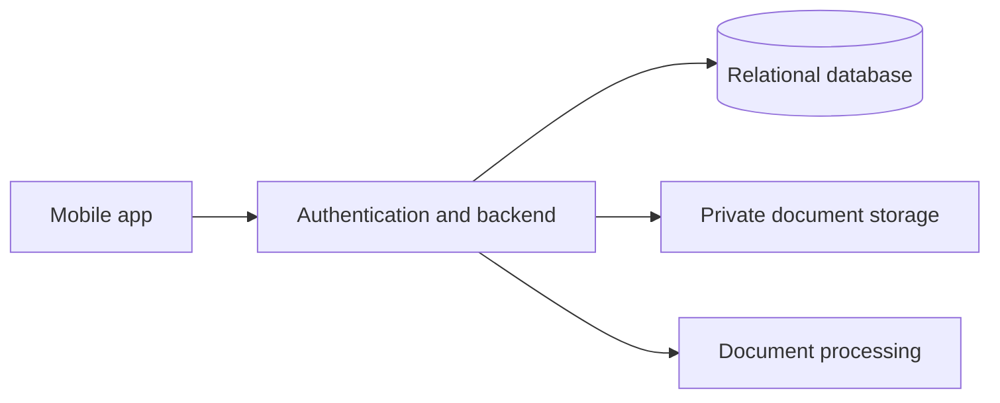

# Household

**A mobile product for managing shared household expenses, recurring bills and balances.**

Household is designed for roommates, couples and families who want a clearer picture of shared financial responsibilities. It brings expenses, bill periods, receipts and settlements into one mobile experience.

## Product capabilities

- Manage shared households, memberships and invitations.
- Record expenses and recurring bills, and split costs equally, by percentage or by a custom amount.
- Track who paid, who owes money and settlements between members.
- Attach receipts and review information extracted from documents before saving.
- Support Hebrew and English in a mobile-native interface.

## Technical overview

| Layer | Technology | Responsibility |
|---|---|---|
| Mobile | React Native, Expo, TypeScript | User interface, navigation and state |
| Backend | Supabase, PostgreSQL | Authentication, scoped data access and persistence |
| Documents | Private storage, Azure Document Intelligence | Receipt handling and assisted extraction |
| Quality | TypeScript and automated tests | Financial calculations, workflows and data isolation |

## Engineering challenges

- Keeping payment records and expense responsibility separate so balances are consistent.
- Modeling recurring bills while retaining historical billing records.
- Handling extracted receipt data with a user review step.
- Designing access boundaries for multiple households and private documents.
- Testing financial calculations and multi-user behavior.

## Project status

Household is a personal product under active development. This repository is a public portfolio case study. Product source code, infrastructure configuration and user data are maintained privately.

**Developer:** Daniel Ayala · [LinkedIn](https://www.linkedin.com/in/danielayalla/)
